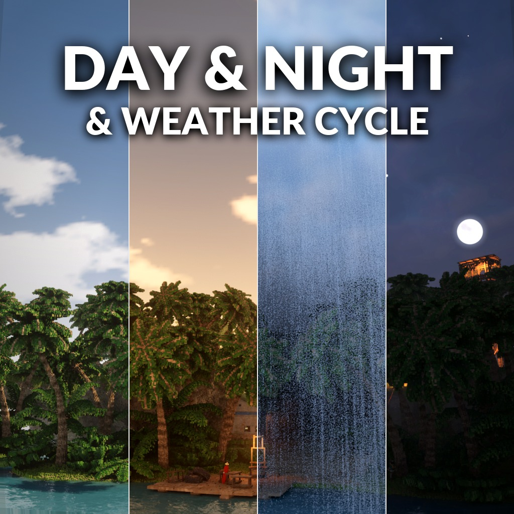

# Day & Night & Weather Cycle



On the Steam Workshop: [Day & Night & Weather Cycle](https://steamcommunity.com/sharedfiles/filedetails/?id=3838065082)

**A day and night cycle with weather, on any map, in single player and multiplayer.** The sun crosses the sky and sets, the lamps come on, the moon rises over a sky full of stars, and the night is really dark. Now and then the weather turns: clouds close in, it rains, a thunderstorm passes, fog settles.

## What it does
- The **sun moves** across the sky from sunrise to sunset, and the shadows turn with it.
- **Sunset and sunrise** colour the sky and the light.
- At night the map's **lamps come on**, the **moon** crosses the sky and the **stars** turn with it.
- **Dark nights**: away from the lamps you see very little. Lamps and fires stay as bright as ever.
- It works on **any map**. Turn the mod off and every map is as it was.

## Weather
- **Clouds** close the sky, dim the sun and hide the stars.
- **Rain** comes after the clouds, light or heavy. The ground gets wet and stays wet for a while after.
- **Thunderstorms**: heavy rain, thunder, and lightning that lights up the whole map. The light swells and fades; there are no hard flashes.
- **Fog** settles close in.
- They **overlap**: fog in the rain, a storm at night, clouds at sunset.
- Clear skies are the rule. Every few minutes the dice are rolled, and mostly nothing happens. A map can also open with some weather already going.

## Options
- **Daylight lasts** 2 to 45 minutes and **night lasts** 1 to 30 minutes. By default a day and a night take 15 minutes, 6 of them night.
- **Weather**: off, rare (the default), sometimes or often.
- **A map starts** in the morning, at noon, in the evening, at night or at a random hour. By default a night map starts at night and any other in the morning.
- **Stars** can be hidden on your own screen.

## Multiplayer
The host's clock runs the sky for everyone, with the host's options. Everyone sees the same time of day.

## For mod and map makers
Day & Night publishes the time in the registry, so a mod can read it (a creature that hunts at night), and a map or a mod can set the hour, freeze the clock, start or switch off the weather, or ask Day & Night to stand down:

```lua
if GetBool("daynight.present") and GetBool("daynight.night") then ... end
GetFloat("daynight.time")    -- the hour, 0-24
GetFloat("daynight.light")   -- daylight, 0 (night) to 1 (noon)
GetString("daynight.weather") -- the strongest: clear, cloudy, rain, storm or fog
GetString("daynight.weather.all") -- everything going on, e.g. "cloudy+rain+fog"
GetFloat("daynight.rain")    -- 0 to 1; also daynight.cloud, daynight.fog, daynight.storm
```

The full list is in API.md in the mod's folder.

## Community

Join the [Discord community](https://discord.gg/gNpRewdkxf) to post bug reports and suggestions.

## Install

Subscribe on the [Steam Workshop](https://steamcommunity.com/sharedfiles/filedetails/?id=3838065082), or clone this repository into
`Documents/Teardown/mods/daynight`. Enable it under **Global mods** (in multiplayer the host does).

## Credits

Made by AgeOfAlgorithms and Claude (Anthropic). MIT licence.
